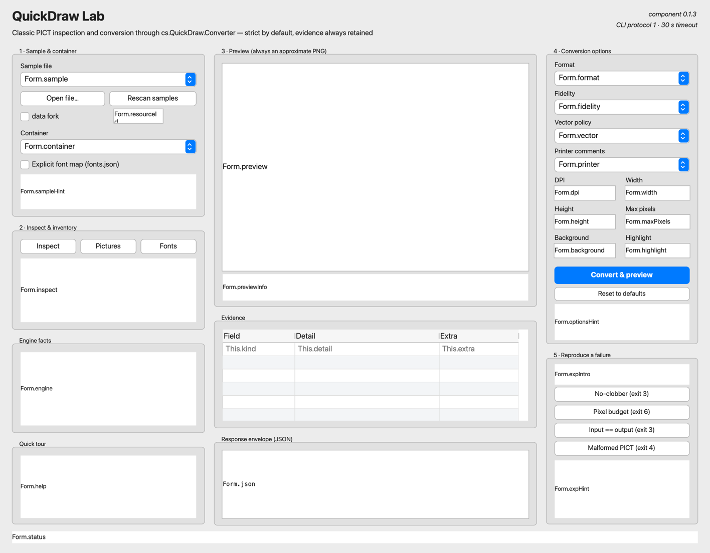

# QuickDraw Lab

An interactive 4D project that uses the [`miyako/quickdraw`](https://github.com/miyako/quickdraw)
component — release tag **0.1.3**, CLI protocol **0.1.0** — to inspect and
convert classic Macintosh **PICT** pictures, resource forks and font resources.

The whole demo is a single form. Pick a sample, inspect its structure, watch
strict mode refuse geometry it cannot reproduce, and see the same picture
convert to PNG, SVG or PDF once you allow approximation and supply a font map.



> The image above is a static rendering of the form template produced with
> `fourdform`, not a runtime screenshot. The form itself is interactive; the
> project is meant to be opened in 4D.

## Why this component is interesting

`quickdraw` is a **CLI-backed** component: 4D code calls a bundled Rust
executable through `4D.SystemWorker`, and every result comes back as a typed
envelope `{ok; stdout; stderr; exitCode; value; failureKind}`. The demo leans on
that boundary instead of hiding it.

Things worth clicking through:

| Point of interest | Where it shows up |
| --- | --- |
| Strict mode is a **portable-coverage contract**, not a bug | `poster.pict` fails at exit 5, offset 200. Switch fidelity to *approximate* and it converts. |
| Every failure carries an offset and an actionable reason | `broken.pict` → exit 4, `no explicit NFNT … id=7, size=3, face=0` for `text.pict` |
| Fonts are **explicit bindings**, never silent substitution | supply `fonts.json` and `text.pict` converts; omit it and strict mode refuses |
| Resource containers are selectable by **exact ID**, never ordinal | `drawing.rsrc` → PICT 128 / PICT 129 / NFNT 7 |
| Budgets fail closed and write nothing | `max-pixels = 1` → exit 6, no partial output |
| Output is never clobbered unless you ask | second write without `--overwrite` → exit 3 (the experiment forces approximate fidelity so the first write succeeds) |
| A preview is always available, honestly labelled | the Preview pane always asks for approximate PNG, even when the strict conversion you requested failed |
| No pixel-identity promise | the `unverified_fidelity` diagnostic is displayed, not swallowed |

## Project layout

```
Project/quickdraw-demo.4DProject
Project/Sources/
  Classes/Lab.4dm              # UI-agnostic wrapper around cs.QuickDraw.Converter
  DatabaseMethods/onStartup.4dm
  Methods/QuickDrawLab.4dm     # startup window pattern (4dstartup skill)
  Methods/Lab_*.4dm            # form handlers + Lab_SelfCheck (headless acceptance)
  Forms/Lab/                   # form.4DForm, method.4dm, 26 ObjectMethods
Resources/Samples/             # deterministic fixtures generated by tools/make_samples.py
Documentation/                 # this report, evidence and rendered artifacts
tools/stage_component.sh       # copy a local quickdraw.4dbase into Components/
tools/run_selfcheck.sh         # headless 13-check acceptance run
.agents/                       # miyako/skills submodule (branch: dist)
```

Clone with `--recurse-submodules` if you want the skills, schema and helper
binaries used while building this project; the demo itself does not need them.

## Using the component as a dependency

`Project/Sources/dependencies.json` declares the real dependency:

```json
{"version": 2100, "dependencies": {"quickdraw": {"github": "miyako/quickdraw", "tag": "0.1.3"}}}
```

Open the project in the 4D IDE, let the **Dependencies** panel install
`quickdraw` 0.1.3, then run `QuickDrawLab` (it is also the On Startup method).

### Running headlessly (tool4d)

`tool4d` does not implement the Dependency manager, so a github+tag entry cannot
be resolved there. Two extra steps make the same code run:

```sh
./tools/stage_component.sh /path/to/quickdraw.4dbase   # populates Components/
./tools/run_selfcheck.sh                               # copies to scratch, uses {} dependencies
```

The runner deliberately copies the project to a scratch folder and writes
`{"version":2100,"dependencies":{}}` so the staged component is used. The
committed `dependencies.json` stays the honest github+tag declaration.

## The form

* **Sample** — poster, flags, text, a resource file and a deliberately broken
  one-byte file; `Open…` and `Rescan` cover your own files.
* **Inspect** — `cs.QuickDraw.Converter.inspect` output: container, PICT
  version, top-level operations, retained diagnostics, full JSON.
* **Options** — format (PNG/SVG/PDF), fidelity (strict/approximate), vector
  policy (reject/raster/preserve), width/height/DPI budget, background,
  highlight colour, font map, data fork and resource ID.
* **Preview** — always approximate PNG, captioned with *why*.
* **Experiments** — one-click no-clobber, pixel-budget, input=output alias and
  malformed-container probes that print the exact failure kind and exit code.
* **Rows** — recent attempts with `kind`, `detail`, `extra`.

## Sample fixtures

`tools/make_samples.py` writes deterministic, dependency-free fixtures:

| File | Bytes | What it proves |
| --- | --- | --- |
| `poster.pict` | 334 | PICT v2 with curve/polygon coverage → strict rejects, approximate converts |
| `flags.pict` | 222 | strict-safe subset |
| `text.pict` | 76 | needs an explicit NFNT binding |
| `font.nfnt` + `fonts.json` | 48 + 69 | schema-1 font map for id 7, size 3, face 0 |
| `drawing.rsrc` | 874 | resource-fork container: PICT 128, PICT 129, NFNT 7 |
| `broken.pict` | 1 | malformed container signature |

CLI evidence: `PICT 128` in `drawing.rsrc` produces the **same SHA-256**
(`ab64b10543169464…`) as `poster.pict`, which confirms the resource really
embeds that picture rather than a lookalike.

## Acceptance evidence

`./tools/run_selfcheck.sh` runs the same class the buttons call and writes
[`Documentation/evidence/selfcheck.json`](Documentation/evidence/selfcheck.json).
Last run: **13/13 passed**, tool4d 21 R5 (100175), macOS arm64, interpreted.

| Check | Observed |
| --- | --- |
| version | envelope `ok:true`, `value {protocol:1, version:"0.1.0"}` |
| capabilities | 3 output formats, default `max_pixels` 16,000,000 |
| strict rejection | exit 5, `unsupported`: curve/polygon/complex region outline needs `--fidelity approximate` |
| approximate inspect | PICT v2, 30 top-level operations |
| explicit font map | without: `no explicit NFNT or outline font binding for id=7, size=3, face=0`; with: ok |
| resource inventory | 2 PICT + 1 NFNT in `drawing.rsrc` |
| png conversion | 50,391 bytes, SHA-256 `ab64b10543169464…` |
| no-clobber | exit 3, `output_exists` |
| pixel budget | exit 6, `resource_limit`, no partial file |
| malformed input | exit 4, `malformed` |
| approximate preview | requested strict SVG, previewed PNG |
| form option wiring | the form model's option builders drive `drawing.rsrc` (resource-id 128) to a PNG; opcode labels read `0x0051`; invalid fields are named |

Compiled-mode host loading is **not** evidenced by tool4d (documented component
limitation); interpreted execution is.

## Chokepoints and findings

The full engineering notes are in [`Documentation/Chokepoints.md`](Documentation/Chokepoints.md).
The short version:

1. **`Get 4D folder` returns an HFS path on macOS.** `Folder(…; fk platform path)`
   fails with `tool4d.FiFo [3] A valid posix path was expected.` Convert with
   `Convert path system to POSIX` and use `fk posix path`, or you get a `Null`
   folder and a cascade of `Object or Collection Expected`.
2. **`inspect` does not accept `fidelity` or `font-map`.** Those are `convert`
   options; passing them returns `invalid_argument`. Strict/approximate is a
   conversion decision, and the demo now demonstrates it that way.
3. **`version()` and `capabilities()` return the process envelope**, not the
   bare payload. Read `.value`.
4. **tool4d runs On Startup before `--startup-method`.** Without
   `--skip-onstartup` the demo tries to open a window and prints
   `tool4d.HDLS (Open form window)` / `DIALOG` errors before the checks.
5. **tool4d cannot resolve github+tag dependencies.** Stage `Components/` and
   use an empty dependency declaration for headless runs; keep the real
   declaration in the repository.
6. **Object dropdowns are placeholder-based.** `currentValue` is write-once at
   init; resolve the selection from `index` first.
7. **`Is number` is not a `Value type` result.** Numeric object properties are
   `Is real`; `Value type($o.index)=Is number` is never true, so the dropdown
   `index` was ignored, offsets never appeared in failure text and `Open…`
   never accepted a file. `Select document` returns Text, not a number.
8. **`On After Edit` reads the previous value.** An input bound to `Form.x`
   still holds the old text during `On After Edit` (and each keystroke would
   launch the CLI). Inputs use `On Data Change`, which fires after the value is
   committed.
9. **Form-dependent methods are `invisible`** (`4dmethods`); only
   `QuickDrawLab` and `Lab_SelfCheck` stay in the Run Method dialog.
10. **Form schema traps:** `multiline` is `"automatic"|"yes"|"no"` (not a
   Boolean) and the input watermark key is `placeholder`.

## Deliberate non-goals

* No promise of pixel identity with classic QuickDraw — the CLI itself reports
  `unverified_fidelity` and the form repeats it.
* SVG/PDF with `vector-policy raster` is a **raster fallback**, not editable
  vectors; the diagnostics say so.
* No cancellation, batching or async UI: protocol 0.1.0 is synchronous with a
  30-second `SystemWorker` timeout.
* Strict mode is not "more correct"; it is a narrower portable-coverage subset.

## Regenerating artifacts

```sh
python3 tools/make_samples.py                       # fixtures (deterministic)
tools/4dform/fourdform Project/Sources/Forms/Lab/form.4DForm \
  --output Documentation/images/lab-form.png --scale 1.2
./tools/run_selfcheck.sh                            # 13 headless checks
```

Conversion images under `Documentation/images/` were produced by the real CLI
from the staged component; e.g.:

```sh
quickdraw convert --input Resources/Samples/poster.pict \
  --output Documentation/images/poster-approximate.png \
  --format png --fidelity approximate --overwrite
```
